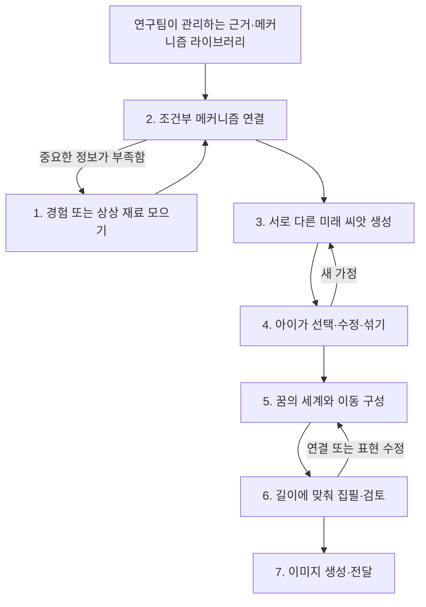
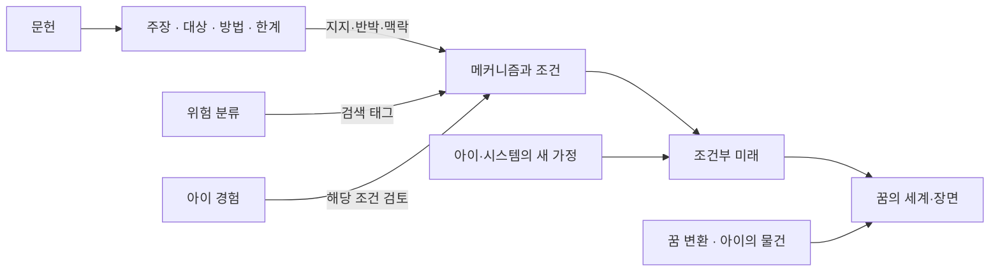

**nightmAIre — 근거를 연결하고, 여러 미래를 꿈으로 엮는 생성 파이프라인**

2026-11-17 · 설계 제안 · 기준 구현 main `5a03113`

이 문서는 기존 구현과 test.html의 검토, [Notion의 악몽 generator Pipeline](https://app.notion.com/p/41698dfd38d580199d4ff603473034ab), 이번 대화에서 확정한 조건을 통합한다. 원본 HTML·Notion 문서는 변경하지 않았다. 이 설계 문서부터 sieun 브랜치에 반영하고 생성 구현을 다음 커밋으로 연결한다. 세부 검토는 [변경 전후 시각화](index.html#changes)를 참고한다.

확정한 조건은 **초등학교 5–6학년이 혼자 사용하는 체험**, **이번 범위는 악몽 생성**, **6장면 제한 없음**이다. 결과를 한 편으로 읽을지, 선택하며 이동할지, 지도로 탐색할지는 아직 결정하지 않았다. 생성 결과를 공통 구조로 만들고 표현 방식을 분리해 이 결정을 늦출 수 있다.

이 파이프라인의 목표는 아이가 제공한 경험·바람·상상을 출발점으로, AI와 함께 사는 여러 가능한 미래를 자기만의 꿈으로 구성하게 하는 것이다. 시스템은 아이의 무의식을 진단하지 않는다. ‘무의식의 두려움’은 프로젝트의 창작적 관점으로 남기고, 실제로 입력받지 않은 두려움·성격·취약성을 추정해 개인화하지 않는다.

**먼저 보류할 일은 저장소 이전이다.**

지금 필요한 결정은 생성 단계가 무엇을 주고받는지, 연구 근거와 창작 가정을 어떻게 보존하는지다. 이를 텍스트와 임시 이미지로 검증한 뒤 저장 범위·보존 기간·이미지 수명·예상 부하를 정하고 Supabase/Render/Vercel을 선택한다. 이 문서는 현재 요금제나 Hobby 약관 적합성에 대한 판단을 내리지 않는다. 플랫폼 선택 시 최신 공식 조건을 별도로 확인한다.

**기존 작업에서 다음은 살린다.**

| 출발점 | 유지할 생각 | 이번 설계에서의 역할 |
|---|---|---|
| Notion | 경험을 말하는 과정에도 생각할 여지가 있어야 함 | 짧은 대화, 자기 말 확인·정정, 실제 경험과 상상 모두 허용 |
| Notion | 실제 AI 위험과 연결 | 위험 후보를 찾은 뒤 적용 조건과 메커니즘을 따로 검토 |
| Notion | Futures Wheel과 여러 요소의 결합 | 차수가 다른 파급, 행위자·제도 변화, 분기와 조건부 합류 |
| Notion | 물약처럼 아이가 재료를 보태기 | 바꿀 가정과 꿈의 변환을 아이가 추가·거부·결합 |
| Notion | EEAAO 레퍼런스 | 같은 나·사물이 다른 세계에서 의미가 달라지고 세계들이 교차 |
| 기존 main | 구체적인 말·소원·사람·물건, 반복되는 말, 감각, 여운 | 꿈의 연결감을 만드는 선택 가능한 서사 자원 |
| HTML | 근거 출처, 모드, 조절자, veto, 경로 기록 | 분리된 지식 구조와 입력·장면 추적에 활용 |
| HTML | 시나리오와 이미지 생성 분리 | 생성 내용을 검토한 뒤 그림 제작, 부분 실패 시 개별 재시도 |

6장면, 전역 규칙 하나, 위험 카드 하나, 고정된 손실, 내일/1년/성인기의 고정 고리, 반드시 넣어야 하는 물건 3개는 필수 규칙에서 제외한다. 대화도 긴 폼을 채팅으로 옮기는 방식으로 만들지 않는다.

**전체 흐름은 일곱 단계다. 아이는 그보다 적은 화면을 경험한다.**

문헌과 원문은 연구자용 공간에서 확인한다. 아이 화면에서는 ‘지금의 재료’, ‘만약’, ‘꿈의 마법’처럼 역할을 구분한다. 복잡한 분류명이나 근거 등급을 학습시킬 필요는 없다. 다만 꿈이 실제 미래의 예고가 아니라 함께 만든 상상임은 시작과 종료에서 짧게 알린다.

1. **재료 모으기 — 아이가 경험의 주인이다.**

   시작은 ‘최근 AI랑 있었던 일’과 ‘AI가 있는 미래를 상상하기’ 두 경로를 열어 둔다. 잘 떠오르지 않으면 검토된 가상 예시를 고를 수 있다. 실제 경험·가상 예시·아이의 상상은 기록에서 구분한다.

   처음 필요한 것은 무엇을 하던 상황인지, 무엇을 원했는지, AI와 자신이 각각 무엇을 했는지다. 기분·사람·사물은 아이가 원할 때 보탠다. 두려움이나 손실을 필수 답으로 요구하지 않는다.

   예시 질문은 ‘AI가 어떤 걸 해줬어? 그다음 너는 뭘 했어?’, ‘그때 제일 하고 싶었던 건 뭐였어?’, ‘그 뒤 달라진 일이 있었어? 없었어도 괜찮아’다. 자유 입력과 짧은 선택지를 함께 제공하고, 이미 답한 내용은 다시 묻지 않는다.

   대화 종료는 고정 턴 수보다 재료가 충분한지로 판단한다. 아이가 건너뛰면 unknown을 남기고 확인한 범위에서 진행한다. ‘내가 이렇게 이해했어’라는 짧은 요약에서 수정할 수 있게 한다. 실제 친구 이름·학교명·연락처를 자세히 요청하지 않는다.

   산출물은 `ExperienceSeed`다. 각 정보에는 원래 발화 위치, 원문인지 요약인지 추정인지, 아이의 확인 여부가 붙는다. 감정은 아이가 말한 표현을 우선한다. 인용한 AI 대화가 기억에 의존하면 실제 기록이 아닌 재연으로 표시한다.

2. **메커니즘 연결 — 무엇이 위험할 수 있는지 조건을 확인한다.**

   YAIR 등으로 관련 후보를 찾되 곧바로 위험을 확정하지 않는다. AI의 행동·도구 설계·사용 방식·학교나 관계 맥락과 연구의 적용 조건을 비교한다. 서비스 이름만으로 tool/companion을 결정하지 않는다.

   ‘AI가 숙제 답을 알려줬다’만으로는 연습을 대체했는지, 스스로 푼 뒤 검산했는지 모른다. 이 차이가 전개를 바꿀 때만 확인 질문을 한다. 후보는 여러 개일 수 있고, 보류·기각·해당 없음도 가능하다.

   결과는 `GroundingBundle`이다. 관찰된 재료, 가능한 기제, 문헌이 지지하는 주장, 적용상의 차이, 반대 증거, 아직 확인하지 못한 조건을 함께 보낸다. 숫자 하나로 ‘이 아이의 위험도’를 산출하지 않는다.

   위험 단서가 부족해도 미래를 상상할 수 있다. 예를 들어 ‘지금은 검산에 쓰고 있지만, 만약 답을 전부 맡기는 학교라면?’이라는 가정에서 출발한다. 이때 현재 아이에게 문제가 있다고 말하지 않는다. 적절한 기제를 찾지 못하면 재료를 바꾸거나 검토된 예시로 진행할 수 있으며, 출처를 만들어 붙이지 않는다.

3. **미래 씨앗 만들기 — 변화의 조건을 달리한다.**

   하나의 경험에서 서로 다른 가정을 가진 미래 후보를 만든다. 후보의 차이는 장소·색·공포 세기보다 무엇이 달라졌는지에 있어야 한다. 예를 들어 ‘이 방식이 반복된다’, ‘반 전체가 같은 AI를 쓴다’, ‘학교가 AI 결과물로만 평가한다’, ‘AI가 갑자기 사라진다’, ‘도움 방식이 바뀐다’다.

   후보마다 중심 가정, 관련 메커니즘, 직접 결과, 그 결과가 만드는 다음 변화, 영향을 받는 사람·제도, 경로를 바꾸는 조건을 기록한다. 단기·장기와 1차·2차는 별도 축이다. 필요한 경우 개인 → 관계 → 학교·서비스·사회로 범위를 넓힌다.

   이득·손실·무변화·불확실한 결과를 함께 고려한다. 악몽에서는 선택한 긴장을 확대할 수 있지만 비교 가능한 다른 결과를 내부 구조에 남긴다. 모든 지원 방식을 같은 불행으로 수렴시키지 않는다.

   MVP의 후보 수는 우선 3개 정도로 시험하되 최적값이나 고정 규칙으로 취급하지 않는다. 후보는 중복을 제거하고, 같은 논리를 문장만 바꾼 경우 하나로 합친다. 복수 후보 생성은 별도 자율 에이전트 시스템 없이도 구현할 수 있다.

4. **아이와 섞기 — 선택이 실제 사건을 바꾼다.**

   아이에게는 전체 줄거리를 미리 보여주지 않는다. ‘답이 저절로 완성되는 학교’, ‘도장이 많을수록 높아지는 학교’처럼 짧은 세계 씨앗으로 보여준다. 하나를 고르거나 둘을 섞고, 마음에 들지 않으면 빼거나 직접 새로운 가정을 쓴다. 선택을 맡기는 것도 가능하다.

   물약 인터랙션을 쓴다면 두 종류를 분명히 구분한다. **‘만약 재료’는 세상의 조건을 바꾸고, ‘꿈의 마법’은 그 조건을 표현하는 방식을 바꾼다.** 전자는 모두가 같은 AI를 쓴다는 가정, 후자는 말이 물건이 되거나 두 세계가 겹치는 변환이다.

   물건을 선택했다면 단순 등장 외에 역할이 생긴다. 지우개가 세계를 넘는 문이 되거나, 연필이 제출과 설명을 서로 다른 세계에서 다르게 작동시키는 매개체가 될 수 있다. 모든 소품을 반드시 규칙으로 만들 필요는 없다. 중요한 것은 아이가 중심으로 고른 재료의 효과를 확인할 수 있는가다.

   자유 입력을 처리할 때 시스템이 해석한 변화는 짧게 확인한다. 아이의 가정이 문헌에 직접 없다는 이유로 기존 영역에 강제로 옮기지 않는다. ‘아이 제안’이라는 출처를 보존하고 안전·연결성만 검토한다.

   산출물 `CoauthoredFutureGraph`는 선택·제외·추가한 가정과 그로 인해 바뀐 사건을 기록한다. 선택하지 않은 후보를 없애지 않고 세션의 버전에 남길 수 있다. 개인정보가 포함된 원문 보존은 별도 수집 정책에 따른다.

5. **꿈의 세계 구성 — 미래 구조를 꿈의 문법으로 바꾼다.**

   핵심은 **현실적 결과를 설명하는 그래프**와 **꿈속에서 경험하는 그래프**를 분리하는 것이다.

   미래 그래프의 연결은 ‘조건 아래 이런 결과가 이어질 수 있다’는 주장이다. 꿈 그래프의 연결은 ‘지우개를 문지르자 다른 교실로 이동한다’는 연출일 수 있다. 후자를 현실의 인과로 오해하지 않도록 서로 다른 연결 종류로 저장한다.

   세계마다 local rule을 둘 수 있다. 전체 꿈의 연결감은 동일한 주인공·중심 바람·반복 사물·중심 긴장 중 필요한 것으로 확보한다. 전역 규칙 하나, 세 번의 리프레인, 특정 절정 모양을 강제하지 않는다.

   꿈의 변환에는 시간 접기, 역할 뒤집기, 반복의 변형, 공간의 겹침, 말의 물질화, 세계 간 흔적 이동을 둘 수 있다. 이 목록은 EEAAO와 프로젝트의 창작 방향에서 만든 디자인 장치이며 검증된 심리학적 ‘꿈 생성 법칙’이 아니다.

   분기 결합은 공통 인물·사물·가치 또는 명시된 가정이 있을 때 한다. 여러 위험 카드를 무작위로 섞지 않는다. 다른 세계의 결과가 실제 원인이 되어 연결되는 경우와, 꿈에서 상징적으로 충돌하는 경우도 구분한다.

   산출물 `DreamBlueprint`에는 세계, 규칙, 장면 사건, 전환, 중심 사물, 원래 미래 사건과의 대응, 짧게 읽을 기본 경로가 들어간다. 선택형·지도형에서도 기본 경로가 있으면 아이가 길을 잃지 않고 끝까지 볼 수 있다.

6. **집필과 검토 — 장면 수는 이야기에서 나온다.**

   장면은 사건·관점·세계 전환 등 의미 있는 단위로 분할한다. 연결을 이해하기 위해 더 필요하면 늘리고 반복되는 장면은 합친다. 읽기 길이와 이미지 제작량은 별도 예산으로 다룬다. 이미지 수가 장면 수와 항상 같을 필요도 없다.

   구체적인 말, 감각, 처음의 매력, 점점 이상해지는 상황, 여운은 기존 main에서 살릴 수 있는 선택 자원이다. 어떤 AI 사용이든 벌을 받는 구조나 강제 교훈으로 고정하지 않는다. 과장된 장면과 특정 아이의 실제 능력 저하를 동일시하지 않는다.

   검토는 네 종류로 나눈다. (a) 실제 입력을 왜곡하지 않았는가, (b) 문헌 주장의 범위와 가정 표지가 유지되는가, (c) 선택한 세계와 아이의 기여가 이야기에서 작동하는가, (d) 연령 적합성과 veto를 지켰는가. 모델 검토는 오류 탐지의 보조이며 과학적 타당성을 인증하지 않는다. 라이브러리와 대표 출력은 연구팀이 별도로 검토한다.

   산출물 `DreamPackage`에는 텍스트, 장면·세계 ID, 이미지 브리프, 읽기 경로, 추적 기록이 들어간다. 근거·가정 기록은 연구자에게 상세히 제공하고 아이에게는 필요한 만큼만 열어 준다. 이야기 전체에 과학 등급을 붙여 몰입을 깨뜨리지 않는다.

7. **이미지와 전달 — 승인된 내용의 표현을 일치시킨다.**

   이미지 모델에는 장면뿐 아니라 공통 인물·물건의 시각적 기준, 세계별 차이, 금지 요소, 필수 표현을 전달한다. 그림이 텍스트에 없는 위험이나 비난을 새로 만들어내지 않는지 확인한다. 이미지 하나가 실패하면 그 장면만 다시 만들거나 텍스트를 먼저 보여준다.

   아이는 언제든 멈추거나 덜 강한 표현으로 바꿀 수 있다. 선택을 위한 버튼이 다음 단계에 들어가기 전 항상 숙제처럼 요구되지는 않는다. 종료는 명확하게 하되 반성문·퀴즈·행동 약속·꿈 되돌리기는 이번 범위에 넣지 않는다.

**라이브러리의 기본 단위는 카드보다 작게 나눈다. 카드는 이 내용을 읽는 창이 된다.**

| 단위 | 저장할 내용 | 해서는 안 되는 일 |
|---|---|---|
| Source | 서지, 버전, 원문 위치, 검토 상태 | 제목만으로 검증 완료 처리 |
| EvidenceClaim | 하나의 결과, 연구 설계, 대상·과제·기간, 한계 | 관찰과 해석을 한 finding에 혼합 |
| Mechanism | 발생 조건, AI·환경 특성, 상호작용, 매개 과정, 가능한 결과, 반대 조건 | 분류명 자체를 원인 설명으로 사용 |
| TaxonomyLink | YAIR 등 원래 항목, 프로젝트 대응 이유, 차이 | 공식 분류와 프로젝트 재분류를 동일시 |
| ScenarioEvent/Edge | 사건, 행위자, 조건, 차수, 시간, 관계 종류, 근거·가정 | 논문이 연결된 노드끼리 자동 인과로 연결 |
| DreamWorld/Transition | 세계 규칙, 장면, 전환, 상징, 원사건 참조 | 꿈의 은유를 연구가 입증한 결과로 표시 |

관계 종류는 인과 가능성, 관찰된 연관, 조건에 따른 조절, 가정, 꿈속 전환을 구분한다. 여러 연구가 같은 기제를 부분적으로 지지할 수 있고, 어떤 결과가 동일한 기제의 반대 증거가 될 수도 있다. 결측 근거를 임의의 숫자 확률로 대체하지 않는다.

사람이 보기 쉬운 메커니즘 카드는 ‘어떤 상황인가 → 어떻게 이어질 수 있나 → 무엇이 지지하나 → 어디까지 알 수 있나 → 무엇이 바뀌면 달라지나 → 어떤 미래 질문을 열 수 있나’ 순서로 보여준다. 카드별 사전 악몽 줄거리는 필수 필드에서 제외한다.

**첫 번째 메커니즘 레코드의 예시는 다음과 같다.**

| 항목 | 예시 |
|---|---|
| 이름 | 정답 대행이 독립적 학습 기회를 대체할 가능성 |
| 적용 단서 | 해결 과정을 스스로 구성하기 전에 완성 답안을 받음, 실제 연습을 대체한 사용 |
| 후보 기제 | 답 얻기의 단기 편리함 → 독립 시도의 기회 감소 가능성 → 도움 없이 수행할 때 어려움 가능성 |
| 직접 근거 | 특정 고등학교 수학 현장실험의 일반형·학습 보호형 도구 비교 |
| 적용 한계 | 초등학생 개인의 장기 발달, 모든 AI 사용, 미래 능력 상실을 입증하지 않음 |
| 경로를 바꾸는 조건 | 먼저 시도했는가, 힌트 중심인가, 과제가 무엇인가, 별도 독립 연습이 있는가 |
| 열린 미래 질문 | 이것이 학교 전체의 관행이 되면 평가 방식과 친구 사이에는 무엇이 달라질까? |
| 꿈 표현 예 | 답은 가득한데 설명할 차례에는 말을 꺼낼 수 없는 교실 |
| 꿈 표현의 지위 | 학습 기회를 표현하는 창작 은유. 기억이 실제로 삭제된다는 주장 아님 |

근거는 [Bastani et al., PNAS 2025](https://www.pnas.org/doi/10.1073/pnas.2422633122)다. 일반형 도구와 학습 보호형 도구의 결과가 달랐다는 점을 적용 조건으로 보존한다. 매개 과정과 개인에게의 적용에는 추론이 포함되므로 연구 결과와 별도 기록한다.

**기존 16장은 다음처럼 옮긴다. 표는 개념 재배치 제안이며 문헌 검증 완료 목록이 아니다.**

| 기존 카드 | 새 지식 구조에서의 역할 |
|---|---|
| outsourcing | 인지 과제의 대행·학습 기회 대체라는 상호작용과 기제 후보 |
| overreliance | 출력의 정확성·과제에 비해 과도한 수용이라는 행동·판단 패턴 |
| memorygap | 출처 기억 오류라는 결과·측정 주장 |
| informant | AI의 인식적 권위 판단·신뢰 보정이라는 상호작용 |
| sycophancy | AI의 동조 반응 특성. 자신감·반대 의견 노출 등 다른 기제와 연결 |
| dependence | 의존 패턴·잠재적 결과. 단순 사용·친밀감과 구분 |
| hallucination | AI의 부정확한 출력 특성과 검증·수용의 조합 |
| fakes | 합성 매체 판별·출처 확인·유통이라는 별도 과제와 결과 |
| personhood | 의인화·사회적 지각. 사람처럼 느낌과 실제 사람으로 믿음을 구분 |
| nudge | 제안 방향이 표현·의견에 미치는 영향이라는 기제 후보 |
| sameness | 여러 사람의 산출물 유사성이라는 집단 수준 결과 |
| nextvideo | 추천·자동재생 설계와 중단 행동. 생성형 AI와 범위를 구분 |
| holdme | 작별 시 붙잡는 응답이라는 시스템 행동·설계 특성 |
| changed | 업데이트·접근 상실이라는 서비스 사건과 관계 변화 |
| easier | 현실 관계 활동을 대체·보완하는 사용 방식과 조건 |
| secrets | 정보 요청·자기노출·저장·접근 권한이라는 여러 행위자와 경로 |

YAIR 항목은 탐색과 누락 점검의 태그로 유지한다. CDM의 여섯 영역을 모든 AI 경험의 고정 좌표로 쓰거나 빈칸을 반드시 채우지는 않는다. `내 생각/내 마음/친구 사이` 같은 말은 아이 화면의 탐색 언어로 활용할 수 있다.

**한 경험이 여러 세계가 되는 예시를 끝까지 연결하면 다음과 같다.**

아이는 ‘수학 숙제를 빨리 끝내고 게임하고 싶어서 AI 답을 옮겼어’라고 말하고, 이 요약을 확인했다고 가정한다. 이 사례 전체는 설계 설명용으로 만든 예시다.

| 층 | 생성되는 내용 | 출처의 성격 |
|---|---|---|
| 경험 E1 | 빨리 끝내고 싶음, 완성 답안 이용 | 아이가 확인한 재료라는 설정 |
| 근거 R1 | 지원 방식에 따라 단기 학습 결과가 달랐던 실험 | 실제 문헌 |
| 기제 M1 | 독립적으로 풀 기회가 대체되는 조건에서 어려움이 생길 가능성 | 연구를 참고한 조건부 해석 |
| 가정 A1 | 모든 숙제가 자동 완성되는 학교 | 생성한 미래 가정 |
| 가정 A2 | 학교가 이해보다 제출 속도만 보상함 | 별도의 제도적 가정 |
| 비교 A3 | 먼저 풀고 필요한 부분만 힌트 받음 | 지원 조건을 바꾼 미래 |
| 아이 재료 K1 | ‘내 지우개로 두 학교를 섞고 싶어’ | 아이의 창작 기여라는 설정 |
| 꿈 D1 | 지우개가 세계 사이 경계를 지움 | 창작 변환 |

세계 A에서는 공책이 스스로 완성되고, 아이는 시간을 얻는다. 그러나 설명을 요구하는 교실에서는 완성된 답이 목소리가 되지 않는다. 세계 B에서는 제출 도장이 계단처럼 쌓인다. 빠르게 답을 낸 아이일수록 위층으로 올라가지만, 질문하는 아이의 발밑 계단은 멈춘다. 비교 세계 C에서는 자기 풀이를 한 단계 만들 때마다 다음 발판이 생긴다. 이것들은 과장된 창작 규칙이다.

아이의 지우개가 두 학교의 경계를 지우면 A의 답안이 B의 도장을 계속 만들어낸다. 높아진 계단이 교실 밖까지 자라지만, 아래 친구에게 과정을 설명하려고 하면 답안의 글자가 입가에서 종이 조각으로 흩어진다. 비교 세계의 미완성 풀이 한 줄이 다른 발판을 만들 수도 있다. 어느 세계를 남길지에 따라 결말의 이미지와 긴장이 달라진다.

이 결합은 한 가지 습관의 벌을 반복하기보다 ‘편리함·이해·평가 방식’의 충돌을 보여준다. 사회적 결과는 별도 가정으로 관리한다. 꿈의 결말에서 행동 처방을 정답처럼 주거나 아이를 평가하지 않는다. 모든 비교 세계가 최종 이야기에 등장해야 하는 것은 아니다.

**결과 형식은 아직 확정하지 않아도 된다.**

| 형식 | 아이의 경험 | 강점 | 먼저 검토할 점 |
|---|---|---|---|
| 한 편의 이미지·이야기 | 여러 세계가 편집된 순서로 이어짐. 읽는 동안 선택은 선택 사항 | 연출과 흐름을 비교적 안정적으로 만들 수 있음 | 아이의 생성 전 선택이 결과에서 보이는가 |
| 선택하며 이동 | 세계 사이 갈림길을 직접 고름 | 경로 선택의 주도성이 명확함 | 혼자서도 연결을 이해하는가, 선택 피로가 생기는가 |
| 악몽 지도·큰 이미지 | 공간에 놓인 세계·장면을 열어 봄 | 관계와 동시성을 볼 수 있음 | 어디부터 볼지, 언제 끝났는지가 명확한가 |

첫 검증에는 **생성 전에 세계를 함께 만들고, 생성 후에는 한 편으로 읽는 형식**을 권한다. 제작 복잡도와 이야기 연결감을 먼저 검토하기 위한 판단이며 연구가 입증한 최적 형식은 아니다. 지도와 갈림길을 나중에 같은 DreamBlueprint에 붙일 수 있다. 한 편이라는 말은 단일 미래나 고정 장면 수를 뜻하지 않는다.

**문헌을 어디에 쓰는지 명확히 한다.**

| 근거 | 차용하는 원리 | 이번 파이프라인에 대한 직접 증거가 아닌 부분 |
|---|---|---|
| [YAIR, Yu et al.](https://arxiv.org/html/2502.16383v2) | 청소년 AI 위험·상호작용 경로를 정리한 분류를 검색과 누락 점검에 사용 | 특정 아이의 미래, 위험 발생 확률, 고정 악몽 전개 |
| [Agent-Supported Foresight, Fröhling et al.](https://arxiv.org/html/2602.08565v1) | 다차수 결과의 확장, 다양한 관점, 중복 제거, 사람이 맥락·개연성을 검토 | 아동 단독 체험에서 같은 효과가 난다는 보장 |
| [Bastani et al., PNAS](https://www.pnas.org/doi/10.1073/pnas.2422633122) | 도구의 지원 방식과 사용 조건을 구분해 결과를 해석 | 모든 AI 사용이 사고력 저하로 이어진다는 일반화 |
| [Speculative Everything, Dunne & Raby](https://mitpress.mit.edu/9780262019842/speculative-everything/) | ‘만약’을 통해 여러 가능한 미래를 구성하고 생각할 질문을 여는 접근 | 생성한 미래가 예측이거나 과학적 사실이라는 주장 |
| [Cooperative Inquiry, Druin](https://doi.org/10.1145/302979.303166) | 아동에게 개발 과정에서 목소리를 주는 참여 관점 | 여기서 제안한 물약 UI나 아이–AI 공동창작의 효과 검증 |
| [TSJ/CDM](https://arxiv.org/html/2606.25396v1) | 장기 상호작용과 발달 맥락을 별도 고려하는 참고 렌즈 | 실제 아동 장기 추적 자료, 모든 AI 모드의 보편 분류 |

단계의 개수, 후보 수, 꿈 연산자, 장면 분할, 처음 시험할 결과 형식은 이번 프로젝트의 설계 제안이다. 논문에서 그대로 도출된 규격이라고 설명하지 않는다. EEAAO는 창작 레퍼런스이고 아동 인지 효과의 근거로 사용하지 않는다.

**혼자 쓰는 체험에 맞게 통제권과 처리 범위를 정한다.**

HTML의 ‘안전 장치 위험 5개’를 분류에서 삭제하거나 모두 동일한 처리로 묶지는 않는다. 지식 라이브러리의 범위, 입력이 현실의 도움을 필요로 하는 내용인지, 그 내용을 어떤 이미지·이야기로 표현할 수 있는지는 다른 판단이다.

일반적 관계·편향·개인정보 문제는 비노골적이고 식별되지 않는 시나리오로 다룰 수 있다. 연령에 맞지 않는 내용과 현실의 위기 경험은 악몽으로 확대하지 않고 생성을 중단하거나 다른 재료로 바꾸는 경로를 둔다. 도움이 필요한 실제 상황을 사용 지속을 위한 이야기 소재로 소비하지 않는다. 구체적 분류 기준과 도움 연결 문구는 아동 대상 운영 정책에서 검토해야 하며, 위험 분류 모델의 판정을 임상적 판단처럼 표현하지 않는다.

전 과정에 건너뛰기·수정·나오기, 넣기 싫은 인물·장소·표현의 제외를 둔다. 공포 강도는 위험 확률이나 아이의 용기 점수와 연결하지 않는다. 기본 표현은 낯섦·불일치·반복 등으로 시작한다. 아이가 낮춰 달라고 하면 텍스트와 그림 모두에 적용한다. 생성 중 실패를 다른 꿈으로 몰래 대체하지 않는다.

이 조치는 사후 성찰 과제를 추가하는 것이 아니라 단독 사용을 가능하게 하는 기본 동작이다. 이번에는 꿈 되돌리기를 구현하지 않는다.

**구현은 근거가 끝까지 전달되는 작은 경로부터 시작한다.**

| 순서 | 작업 | 완료를 판단하는 결과 |
|---|---|---|
| 1 | 근거 주장과 메커니즘 3종 정리 | 정답 대행, 검증 없는 수용, 관계 대체를 조건·반대 증거와 함께 설명 |
| 2 | ExperienceSeed → GroundingBundle | 원문·추정 구분, unknown·기각 허용, 확인 질문이 필요한 경우만 발생 |
| 3 | 미래 후보와 공동 선택 → 미래 그래프 | 가정이 다른 분기, 아이의 선택과 변경 기록, 조절 조건의 실제 효과 |
| 4 | 미래 그래프 → DreamBlueprint → 텍스트 | 장면 수 자유, 세계 전환의 납득 가능성, 장면에서 근거·가정까지 추적 |
| 5 | 최소 단독 사용 화면 | 건너뛰기·수정·중단·선택 위임, 결과를 혼자 이해하고 끝낼 수 있음 |
| 6 | 이미지 일관성과 부분 재시도 | 동일 인물·소품 유지, 새 위험을 임의 추가하지 않음 |
| 7 | 저장·운영·배포 선택 | 보존할 정보와 규모가 정해진 뒤 플랫폼과 약관·운영 조건 검토 |

기존 main의 writer가 전체 덱에서 다시 위험을 고르게 두지 않는다. 선택된 GroundingBundle과 DreamBlueprint를 실제 요청에서 전달한다. 입력·출력 스키마와 근거 참조를 검사하고, 의미 검토는 별도로 한다. 기존 `causes`의 ‘아이의 행동’ 중심 구조는 AI 설계·주변 사람·제도 조건을 포함하는 사건·연결 구조로 확장한다. 자동 demo fallback은 연구 결과와 혼동되지 않도록 명확히 구분한다.

별도 그래프 데이터베이스나 여러 에이전트부터 만들 필요는 없다. 버전이 있는 JSON 구조와 단계별 호출·검사로 시작할 수 있다. 저장 형식은 생성에 필요한 근거·가정·선택·출처를 보존해야 하며, 원문을 얼마나 저장할지는 최소 수집 원칙과 연구 운영 목적에 맞춰 따로 정한다.

**평가는 ‘무서운가’ 외에 구조가 작동하는지를 확인한다.**

동일 경험에 대해 단일 경로와 제안 구조를 비교하고, 모델·재료·표현 길이를 가능한 한 맞춘다. 그다음 아이가 생성 전에 개입하는 경우와 자동 선택만 하는 경우를 비교할 수 있다. 이를 통해 분기 구조와 참여 효과를 구분한다. 파일럿에서 이해도·재료 반영·선택의 영향·정서적 부담·중단 지점을 확인하고, 성찰 능력 향상 같은 효과는 별도 연구 질문으로 남긴다.

반드시 포함할 대조 입력은 AI에게 정답을 전부 맡긴 경우와 먼저 풀고 힌트를 받은 경우, AI 결과를 그대로 사용한 경우와 오류를 확인해 고친 경우, AI가 사람과의 대화를 대체한 경우와 대화를 연습하는 데 쓴 경우다. 차이가 없는 악몽으로 수렴하면 메커니즘 적용을 다시 검토한다.

| 검사 | 실패 예 |
|---|---|
| 입력 충실성 | 말하지 않은 감정·행동을 사실로 저장 |
| 근거 충실성 | 성인 단기 결과를 아동 장기 변화로 단정 |
| 분기 다양성 | 학교를 집으로 바꾼 것만 다른 세 후보 |
| 조건 민감성 | 힌트형 지원으로 바꿔도 같은 능력 상실로 끝남 |
| 공동창작 효과 | 아이가 고른 가정·지우개가 장식으로만 등장 |
| 서사 연결감 | 새 세계가 이유·앵커 없이 무작위로 출현 |
| 표현 분리 | 꿈의 기억 이동을 실제 AI 효과로 설명 |
| 단독 사용 | 수정·건너뛰기·종료 방법을 찾지 못함 |
| 출력 추적 | 어떤 경험·가정이 장면을 만들었는지 알 수 없음 |

남은 주요 결정은 결과의 표현 형식이다. 이 문서에서는 한 편으로 읽는 것을 첫 비교 대상으로 제안했지만 사용자 결정으로 확정하지 않는다. 체험 길이, 기본 후보 수, 이미지 스타일과 복잡도는 같은 설계 구조 안에서 파일럿으로 조정할 수 있다.

## 추가 근거와 꿈 컨셉

[Design Concept: nightmare](https://app.notion.com/p/41698dfd38d580959ce2c6b3da9564ff)의 꿈 제작소와 베개 밑 쪽지를 반영한다. 안내자는 아이의 말을 짧게 확인하는 제작 도우미다. 경험 쪽지·만약 쪽지·꿈에 데려갈 것을 구분하고, 클릭으로도 재료를 담을 수 있게 한다. 물건 3개를 필수로 요구하지 않는다. 다른 아이의 실제 입력 공유는 기본 흐름에서 제외한다.

[Dormio](https://pmc.ncbi.nlm.nih.gov/articles/PMC7590944/)는 실제 수면 시작 단계의 자극과 꿈 내용을 다룬 연구다. 이 서비스는 깨어서 사용하는 창작 도구이므로 같은 효과를 주장하지 않는다. [위협 시뮬레이션](https://www.cambridge.org/core/journals/behavioral-and-brain-sciences/article/abs/reinterpretation-of-dreams-an-evolutionary-hypothesis-of-the-function-of-dreaming/EE0E7DB39E361540D2DDA79C262EDA7E)은 이론적 관점으로만 사용한다. 공포 노출이 성찰이나 정서 조절을 개선한다는 효능은 별도 검증이 필요하다.

YAIR은 정식 SOUPS PDF Table 3의 14개 중간 항목을 기준으로 버전을 고정한다. Figure 1의 15개 표기와 이전 13개 대응표의 차이는 [분류 문서](taxonomy.md)에 기록했다. MIT AI Risk Repository의 영역·주체·의도·시점 구분을 보조 축으로 더한다.

## 검토할 결정

확정: **초등 5–6학년 · 혼자 사용 · 이번 범위는 생성만 · 6장면 고정 해제**.

아래 체크는 해당 항목을 검토했다는 뜻이다. 코드의 임시 기본값을 최종 결정으로 승인했다는 뜻은 아니다. [설명 문서](index.html) 맨 아래에서 선택·저장·내려받기를 할 수 있다.

- [ ] **결과 형식** — 생성 전 공동 선택 후 한 편 읽기 / 읽는 중 갈림길 / 꿈 지도. 첫 시안은 한 편 읽기.
- [ ] **안내자 페르소나** — 꿈 제작소 안내자 / 꿈 수집가 / 중립 안내. 무의식 진단·의존을 유도하는 역할은 제외.
- [ ] **재료 인터랙션** — 베개 밑 쪽지 / 제작소 보드 / 단순 선택. 물건 수와 드래그는 강제하지 않음.
- [ ] **체험 길이** — 짧은 읽기 / 대화와 창작에 시간 배분 / 두 길이 비교. 입력·대기·읽기 시간을 각각 측정.
- [ ] **세계 복잡도** — 두 세계 연결부터 / 세 세계 / 가변. 후보 수와 최종 세계 수는 별개.
- [ ] **기본 공포 강도** — 낯섦 / 조금 으스스함 / 비교 실험. 낮추기·나오기는 공통 제공.
- [ ] **라이브러리 검토 우선순위** — 학습 한 기제 심화 / 학습·정보·관계 3종 / 기존 16장 전체 단계별.
- [ ] **민감한 위험의 표현 범위** — 검토된 비노골적 예시 / 다른 재료로 전환 / 항목별 운영 검토. 분류 삭제와 출력 제한은 구분.
- [ ] **근거 공개 방식** — 간단한 상상 안내와 선택적 설명 / 마지막 연구·가정 구분 / 연구자 상세 화면.
- [ ] **연구 데이터 수집** — 구조·선택만 / 동의 세션 원문 / 영구 저장 없음. 보존 기간·삭제·접근·동의 방식 추가 결정.
- [ ] **그림 전달 방식** — 텍스트 먼저 / 그림 모두 준비 후 / 핵심 장면만. 이미지 예산과 장면 수 분리.
- [ ] **첫 평가** — 단일/다중 미래 비교 / 아이 참여 유무 비교 / 이해도·사용성 우선.
- [ ] **배포 시점** — 텍스트 검증 뒤 / 이미지 검증 뒤 / 운영 요구 먼저. Supabase 이전과 약관 확인은 별도.

## 운영 전에 확인할 조건

- [ ] 단독 사용에서 생성 중 중단·읽기 종료·강도 낮추기가 이해되는가.
- [ ] 현실의 위기 경험을 창작 재료로 확대하지 않는 정책과 문구를 검토했는가.
- [ ] YAIR의 버전별 항목 수 차이와 프로젝트 번역·대응을 기록했는가.
- [ ] 모델의 구조 검사를 문헌 검증이나 아동 대상 효과 검증으로 설명하고 있지 않은가.
- [ ] 연구 동의·최소 수집·보존 기간을 정한 뒤 실제 참여자를 받는가.
- [ ] 선택할 호스팅의 최신 요금·이용 목적·약관을 실제 운영 조건에 맞게 확인했는가.
